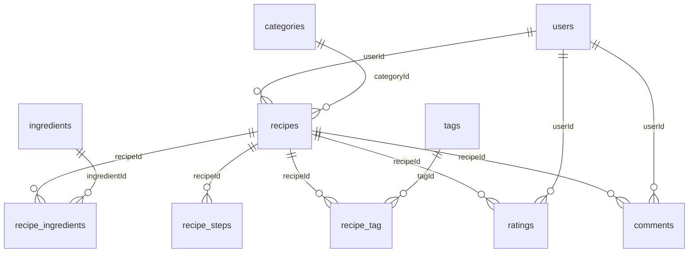
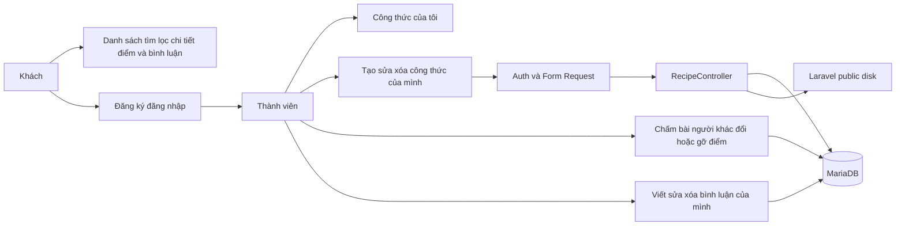

# Hợp đồng source bàn giao

Cập nhật ngày 13/10/2026. Sơ đồ dưới mô tả mã nguồn hiện có; đặc tả gốc và sơ đồ use case đầy đủ ở [00](plans/00_Huong_dan_va_hop_dong_chung.docx). Toàn bộ 10 bảng được định nghĩa trong `database/migrations`; cài mới bằng `php artisan migrate --seed`. Migration nền bỏ qua bảng đã tồn tại để giữ dữ liệu; giữ tên DB máy hiện tại `webcookingrecipe`. Catalog được nạp bởi `CatalogSeeder`, không phụ thuộc SQL ngoài migration.

## ERD 10 bảng

Khóa chính id BIGINT UNSIGNED trừ recipe_tag dùng (recipeId, tagId). Timestamp createdAt/updatedAt; recipe_ingredients/recipe_steps/recipe_tag không timestamp. Unique email, tên catalog, (recipeId,ingredientId), (recipeId,stepOrder), (recipeId,userId) ở ratings. Các FK tới recipe CASCADE; FK tới users/category/ingredient/tag RESTRICT. imageUrl/imageId cùng null hoặc cùng có theo validation/Controller. Không có cột status.

## Luồng chức năng

## Endpoint web

Tất cả request ghi có CSRF. ID số, thiếu bản ghi 404. Bình luận không thuộc recipe trong URL trả 404 trước kiểm tra owner. Đọc công khai; ghi phải đăng nhập, vi phạm owner trả 403 trước validation. Không API JSON/ảnh riêng.

| Method | URL | Named route | Quyền |
| --- | --- | --- | --- |
| GET | / | home | Công khai, alias danh sách |
| GET | /recipes | recipes.index | Công khai |
| GET | /recipes/create | recipes.create | Auth |
| POST | /recipes | recipes.store | Auth |
| GET | /recipes/{recipe} | recipes.show | Công khai |
| GET | /recipes/{recipe}/edit | recipes.edit | Owner |
| PUT | /recipes/{recipe} | recipes.update | Owner |
| DELETE | /recipes/{recipe} | recipes.destroy | Owner |
| GET | /my/recipes | my.recipes.index | Auth, userId từ session |
| GET/POST | /register | register / register.store | Guest |
| GET/POST | /login | login / login.store | Guest |
| POST | /logout | logout | Auth |
| PUT | /recipes/{recipe}/rating | recipes.rating.update | Auth, không owner recipe |
| DELETE | /recipes/{recipe}/rating | recipes.rating.destroy | Auth, không owner recipe |
| POST | /recipes/{recipe}/comments | recipes.comments.store | Auth |
| PUT | /recipes/{recipe}/comments/{comment} | recipes.comments.update | Tác giả comment |
| DELETE | /recipes/{recipe}/comments/{comment} | recipes.comments.destroy | Tác giả comment |

Nguồn kiểm chứng: [route:list](test-report/evidence/routes.txt), routes/web.php, 10 migration trong database/migrations.

RecipeController xử lý trực tiếp store/update/destroy và trả redirect/thông báo; saveChildren, upload và destroyImage là các hàm private dùng chung. Form Request kiểm tra input công thức; quyền vẫn nằm ở Controller/Form Request. Recipe relations: user/category/ingredients/steps/tags/ratings/comments. Dữ liệu chỉ lấy từ validated; image UploadedFile, removeImage boolean. Ảnh lưu trên Laravel public disk, không dùng API ngoài. Ghi DB tuần tự; không hứa rollback toàn bộ DB và file ảnh.
